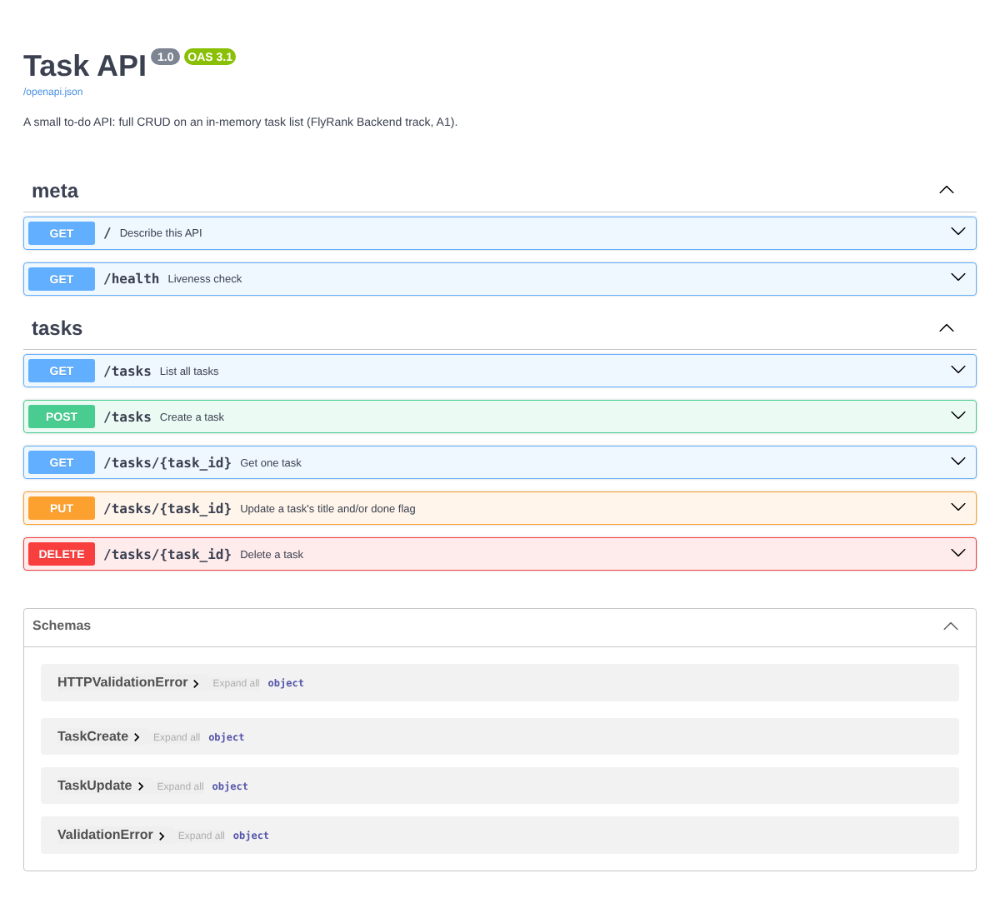

# Task API (FlyRank Backend track, A1: Build your first CRUD API)

A small to-do API in **Python + FastAPI**. You can create, read, update and delete tasks (full CRUD). The data lives
**in memory** for now, so it disappears when the server stops. Swagger UI documents every endpoint at `/docs`.

## Run it (Windows PowerShell; macOS/Linux use `source .venv/bin/activate`)

```powershell
python -m venv .venv
.\.venv\Scripts\Activate.ps1
pip install -r requirements.txt
uvicorn main:app --reload        # → http://localhost:8000  ·  docs: http://localhost:8000/docs
```

Tests (the README's curl checks, automated): `pip install -r requirements-dev.txt` then `pytest -q`. All **12 pass**.

## Endpoints

| Method | Path | What it does | Success | Errors |
|---|---|---|---|---|
| GET | `/` | Describes the API | 200 | — |
| GET | `/health` | Liveness check, returns `{"status":"ok"}` | 200 | — |
| GET | `/tasks` | Lists tasks. Optional `?done=true`, `?search=milk`, `?limit=2&offset=2` | 200 | 400 bad query |
| GET | `/tasks/{id}` | Gets one task | 200 | 404 unknown id |
| POST | `/tasks` | Creates a task from `{"title": "..."}` | **201** | 400 missing/empty title |
| PUT | `/tasks/{id}` | Changes `title` and/or `done` | 200 | 400 empty/invalid body · 404 |
| DELETE | `/tasks/{id}` | Deletes a task | **204** (empty body) | 404 |
| GET | `/stats` | Returns `{"total", "done", "open"}` *(extra)* | 200 | — |
| POST | `/reset` | Restores the 3 example tasks *(extra)* | 200 | — |

Every error is JSON with an `error` key, for example `{"error": "Task 99 not found"}`.

**Design note:** FastAPI answers validation errors with **422** and a `detail` list by default. The contract for this
assignment is **400 + `{"error": ...}`**, so a `RequestValidationError` handler converts them in one place. That way
no route has to remember to do it.

## Proof (a real `curl -i`)

```text
$ curl -i -X POST http://localhost:8000/tasks -H "Content-Type: application/json" -d '{"title":"Buy milk"}'
HTTP/1.1 201 Created
content-type: application/json

{"id":4,"title":"Buy milk","done":false}
```

`curl -i http://localhost:8000/tasks/99` returns `404` and `{"error":"Task 99 not found"}`. Posting `{}` returns `400` and
`{"error":"title: Field required"}`.



## The mortality experiment

Task 4 was created ("Survive a restart?"), so `/stats` showed 4 tasks. Then the server was stopped and restarted, and `/stats`
showed 3 again: the new task was gone. The list lives in the process's memory, so when the process ends, the data ends with it.
That is exactly the problem a database solves in A2.

## Why pagination

Real APIs never return "everything". With thousands of rows, one response would be slow, heavy and mostly unused, so
`limit`/`offset` lets the client ask for one page at a time.

## How AI was used

This project was built **with an AI assistant (Claude)**. The brief asks for Stages 0–6 to be written by hand. This
version wasn't, and that is stated openly here instead of presenting the code as hand-written.

Verified by running it:

- the 12 tests
- the curl outputs above
- the restart experiment
- every status code against the brief's requirements

Because no hand-written version exists to compare against, the optional Stage 7 "AI vs me" isn't included.
